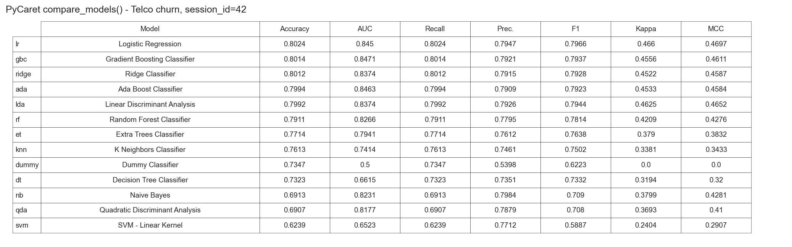
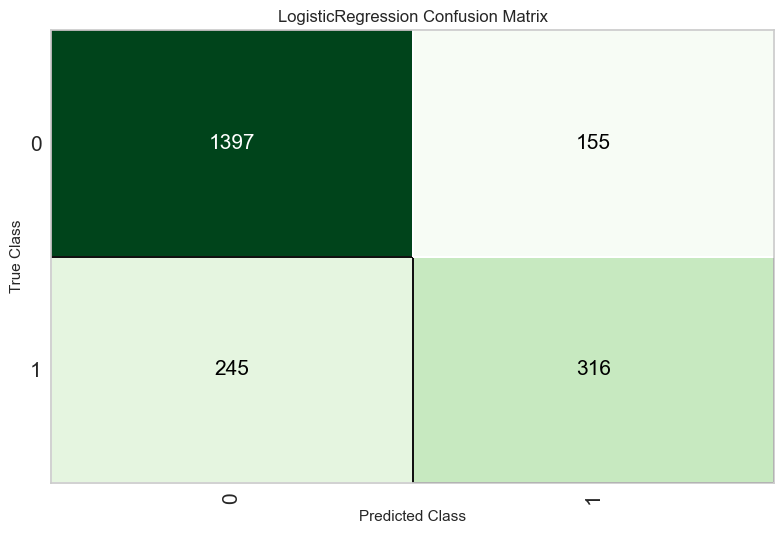
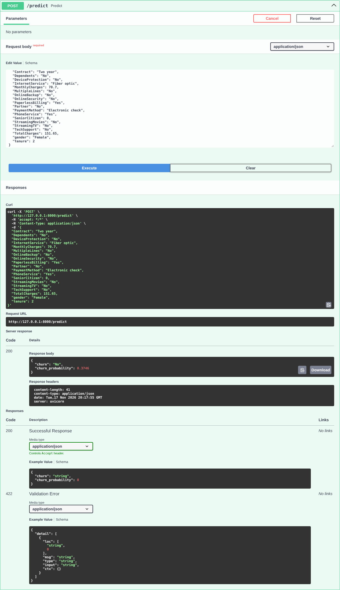

# Telco Customer Churn: Automated ML Pipelines & Model Serving

## Business problem

A telecom company loses revenue every time a subscriber cancels. This project predicts **whether a customer will churn (Yes/No)** from their account, service and billing details, so the retention team can contact at-risk customers with an offer before they leave.

## Dataset

- **Source:** [Telco Customer Churn on Kaggle](https://www.kaggle.com/datasets/blastchar/telco-customer-churn) (IBM sample data, also published at [IBM/telco-customer-churn-on-icp4d](https://github.com/IBM/telco-customer-churn-on-icp4d))
- **File:** `data/telco_churn.csv`, with 7,043 rows, 19 features and the target `Churn` (5,174 No / 1,869 Yes, about 27% churn)
- **Features:** 3 numeric (`tenure`, `MonthlyCharges`, `TotalCharges`), one 0/1 flag (`SeniorCitizen`) and 15 categorical columns (`Contract`, `InternetService`, `PaymentMethod`, …)

**Columns dropped**

| Column | Why |
|---|---|
| `customerID` | A unique ID. It carries no predictive signal and would let a model memorize rows. |

No other column had to be removed for leakage. Every remaining field describes the customer's current account (services, contract, charges, tenure), and all of it is known *before* they decide to leave. The one cleaning step: `TotalCharges` is stored as text and is blank for 11 brand-new customers (tenure 0). I converted it to a number, which leaves those 11 values missing, and the pipeline's imputer fills them in.

## How to run

Requires [uv](https://docs.astral.sh/uv/). The project is pinned to Python 3.11, because PyCaret only supports 3.9–3.11.

```bash
git clone <this-repo-url>
cd ml-pipeline
uv sync                          # installs PyCaret, scikit-learn, FastAPI (~150 packages)
uv run python discovery.py       # both workflows; writes images/ and model.joblib (~3–4 min)
uv run fastapi dev main.py       # serves the model; open http://127.0.0.1:8000/docs
```

## Part 2: Comparing the workflows (`discovery.py`)

### PyCaret

`setup(session_id=42)` → `compare_models(n_select=3)` → `plot_model(best, plot="confusion_matrix", save=True)`.
Top 3 models: **Logistic Regression**, Gradient Boosting, Ridge Classifier.



*(The table is rendered to PNG from PyCaret's `pull()` output, so it's the same numbers `compare_models()` prints. Training-time column omitted.)*



### scikit-learn

Stratified 70/30 `train_test_split` (random_state=42) → `ColumnTransformer` (median impute + `StandardScaler` for numeric; most-frequent impute + `OneHotEncoder` for categorical) → `LogisticRegression` inside a single `Pipeline`, saved as `model.joblib`.

```
              precision    recall  f1-score   support
          No     0.8500    0.8982    0.8734      1552
         Yes     0.6660    0.5615    0.6093       561
    accuracy                         0.8088      2113
   macro avg     0.7580    0.7298    0.7414      2113
weighted avg     0.8011    0.8088    0.8033      2113
```

### Comparison

**Efficiency.** PyCaret was far more efficient in code: its section is 14 lines (setup, compare, plot, plus saving the images), while the scikit-learn section is 43 lines. In run time it was the opposite. PyCaret took **203.8 s**, because it trains 13 model types with 10-fold cross-validation each. The scikit-learn pipeline trains one model once and finished in **0.33 s**. PyCaret is faster for *searching* for a model; scikit-learn is leaner for *building and shipping* the one you chose.

**Why the scores differ.** PyCaret reports Logistic Regression at **0.8024 accuracy / 0.8450 AUC / 0.7966 F1**, averaged across 10 cross-validation folds of the training data. My classification report scores **0.8088 accuracy / 0.8033 weighted F1** on one held-out test set of 2,113 rows. They use different data splits and different preprocessing (PyCaret doesn't scale features by default), and a single test set is noisier than a 10-fold average. One gotcha: PyCaret's Recall column equals its Accuracy (0.8024), so it's a *weighted* average over both classes. Recall on churners alone is much lower: **0.5615** in my report, and PyCaret's confusion matrix on its own hold-out set shows the same pattern (roughly 56% of actual churners caught).

**Metric that matters.** **Recall on the "Yes" class.** A missed churner (false negative) is a lost subscription. A false alarm only costs a discount offer to someone who would have stayed. Right now the model catches only 56% of churners, so the next step would be lowering the decision threshold or using `class_weight="balanced"` to trade some precision for recall.

## Part 3: Serving the model (`main.py`)

The FastAPI app loads `model.joblib` once at startup (in a `lifespan` handler). A Pydantic `Customer` class has one field per feature, and categorical fields are typed as `Literal[...]`, so `/docs` lists the allowed values and rejects typos with a 422 error. `POST /predict` converts the JSON to a one-row DataFrame, calls `model.predict()` and returns the label plus the churn probability.


**Sample input**

```json
{
  "gender": "Female", "SeniorCitizen": 0, "Partner": "No", "Dependents": "No",
  "tenure": 2, "PhoneService": "Yes", "MultipleLines": "No",
  "InternetService": "Fiber optic", "OnlineSecurity": "No", "OnlineBackup": "No",
  "DeviceProtection": "No", "TechSupport": "No", "StreamingTV": "No",
  "StreamingMovies": "No", "Contract": "Month-to-month", "PaperlessBilling": "Yes",
  "PaymentMethod": "Electronic check", "MonthlyCharges": 70.7, "TotalCharges": 151.65
}
```

**Sample output**

```json
{"churn": "Yes", "churn_probability": 0.6916}
```

### Explaining a prediction

| | Input 1 | Input 2 (one change) |
|---|---|---|
| `Contract` | Month-to-month | **Two year** |
| All other fields | identical (above) | identical (above) |
| **Prediction** | **Yes** (churn probability 0.69) | **No** (churn probability 0.37) |



This change makes business sense. A month-to-month customer can leave at any time with no penalty, while a two-year contract locks the customer in and usually signals someone who already plans to stay. In the dataset, 42.7% of month-to-month customers churned versus 2.8% of two-year customers, and the model learned that pattern. It also suggests an action: offer at-risk month-to-month customers an incentive to move to a longer contract. One caveat: the effect isn't purely causal. Customers who *choose* two-year contracts may simply be more loyal to begin with, so moving someone onto a contract won't necessarily cut their risk by the full amount the model shows.

## AI use

**What the AI wrote vs. what I did.** I had an AI assistant write the boilerplate: the `ColumnTransformer`/`Pipeline` code, the FastAPI app and Pydantic schema, and the helper that saves the comparison table as an image. These follow the class examples closely and are easy to check by running them. I made the decisions myself: the dataset, which columns to drop, which metric matters for churn, and how to interpret the prediction experiment. Those depend on understanding the business problem, which the AI can't verify.

**Something I had to check or change.** The AI hard-coded `LogisticRegression` into the scikit-learn pipeline *before* PyCaret had run. I had to confirm from the actual `compare_models()` output that Logistic Regression really ranked first. If it had lost to Gradient Boosting, the "rebuild the best model" step would have been wrong. I also noticed that PyCaret's Recall column was identical to Accuracy. That meant it was a weighted average rather than recall on churners, so I couldn't quote it as "the model catches 80% of churners." The real figure is 56%.
